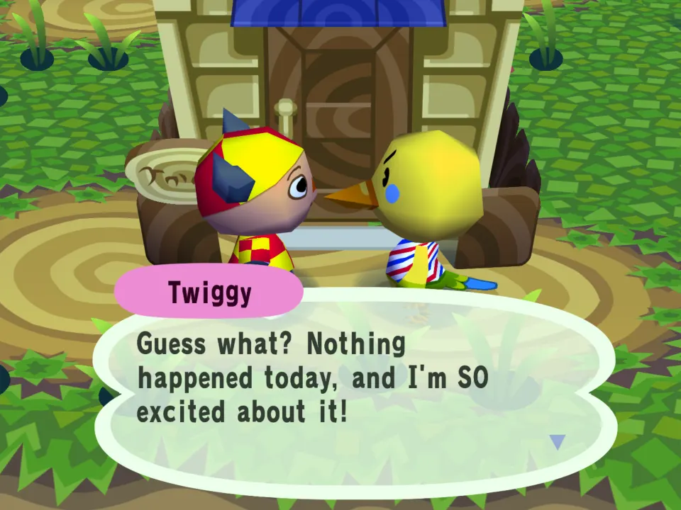
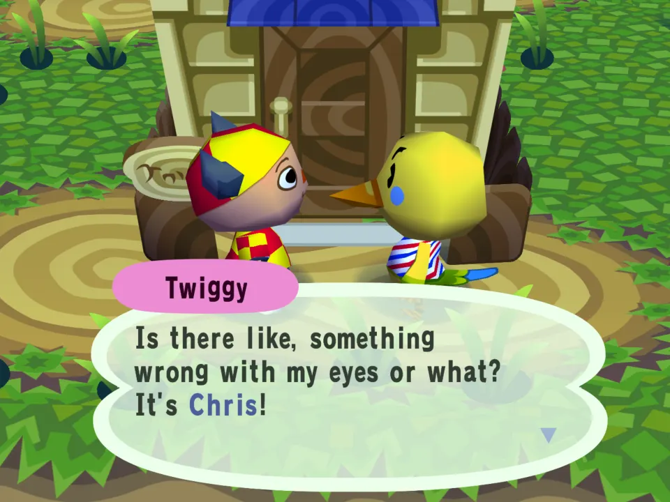
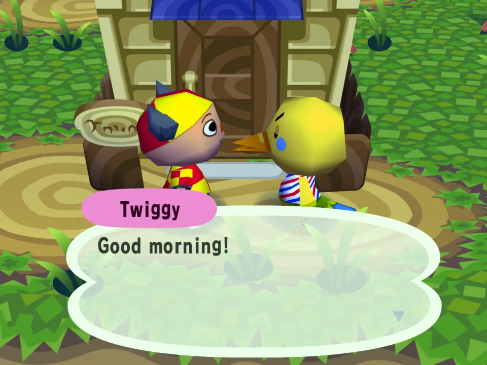

# Chatty Villagers

A villager line pool example (`talk.json`). Client scope: only you hear it.
No script: the game picks the line.

## In the game

The first talk of the day opens on a new line from the mod's talk pools, picked for the villager's personality.

The next page is the villager's own hello: the mod's line comes first, and the game's conversation carries on as usual.

Talk again the same day and there is no mod line: one new line per villager per day.

The film (click the picture): Twiggy's first talk of the day opens on the mod's line, then her own words; a second talk skips straight to her hello.

Each personality has its own pool. On the first ordinary talk of the day a
villager says one line from their personality's pool, then their usual hello,
errands and all. A pool can instead name one villager (`"villager": "Bob"`) or
nobody (every villager), and can say a line only some days (`"chance": 40`).
The most specific pools that match a villager decide.
