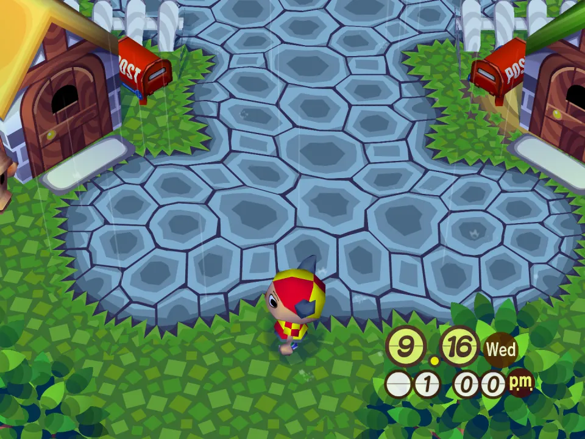
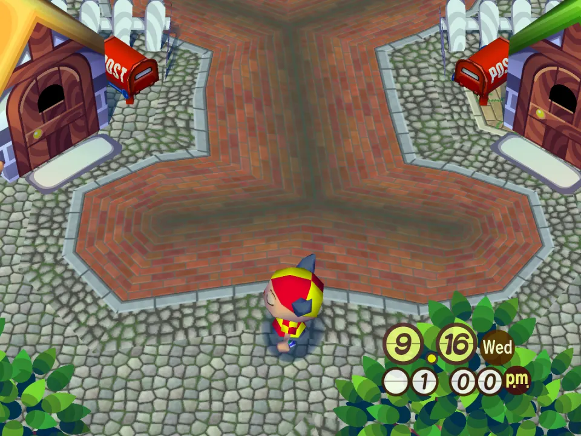
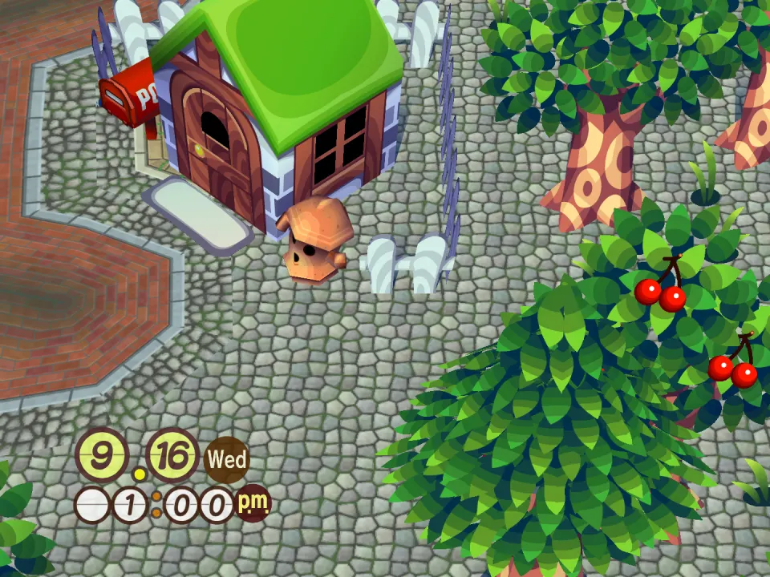
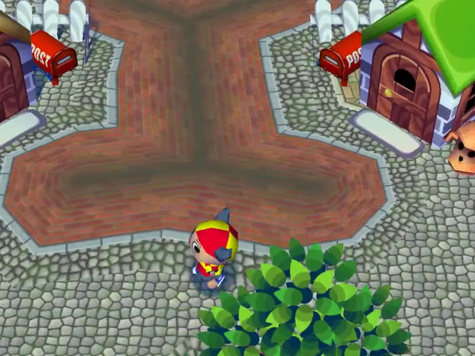

# Cobble Town

A texture-only example mod that turns the whole town to stone: the ground is
cobblestone with moss in the cracks, cliffs are dressed sandstone walls with
ivy under a capstone, and river and pond banks are brick quays that darken
toward the water. In winter the cracks fill with snow and the stones wear a
dusting.

## In the game

Before: the square by the houses with no mods and the HD texture pack: grass and the blue stone paving.

After: the same spot with Cobble Town installed. The ground is the mod's cobblestone, with brick where the stone paving was.

Around the houses the whole town is paved: trees, fences and houses stand on the mod's cobbles.

The film (click the picture): A walk past the houses with Cobble Town installed: the town ground is cobblestone and brick everywhere you go.

Every pixel is drawn by a small program (a seamless Voronoi cobble pattern,
block and brick courses that tile across), never copied from the game. Each
texture is one 128x128 RGBA DDS, named the way the game looks textures up:

    tex1_<width>x<height>_<texture hash>_<palette hash>_<format>.dds

| What | Texture hashes | Palettes |
|---|---|---|
| Ground, spring to autumn | `626709d910129694`, `903adc6355e36f59`, `e96fecd242518c9f` (32x32) | 9 |
| Ground, winter | `82f28ec4199a45be`, `cfa57a6e6f966d11`, `e2ab673814e71af6` (32x32) | 3 |
| Cliff faces, spring to autumn | `99c780e750314916`, `16de5cbb85d58cc0`, `f628105fb6e026fd` (64x64) | 9 |
| Cliff faces, winter | `0dd181f7c8e1d9e1`, `e5488c12d43d6cbc`, `64ac9d75399172f0` (64x64) | 3 |
| River and pond banks, spring to autumn | `1218fdfe9c963f24`, `78690dcebd874a3b`, `2d865e307f1a0fdc` (64x64) | 9 |
| River and pond banks, winter | `2ec0ba79769bedc7`, `b6437b8020145bc6`, `9438dc9288174b5a` (64x64) | 3 |

The cliff and bank textures are strips: their top third is the ground at the
edge, the rest is the face. So the top of our walls is cobbles too, and the
ground meets the wall at a capstone instead of a seam.

The names identify which in-game texture to replace; the pixels are our own.
Clover Meadow and Blossom Lane also replace the grass: when two mods change
the same texture, the lower one in your list wins.
