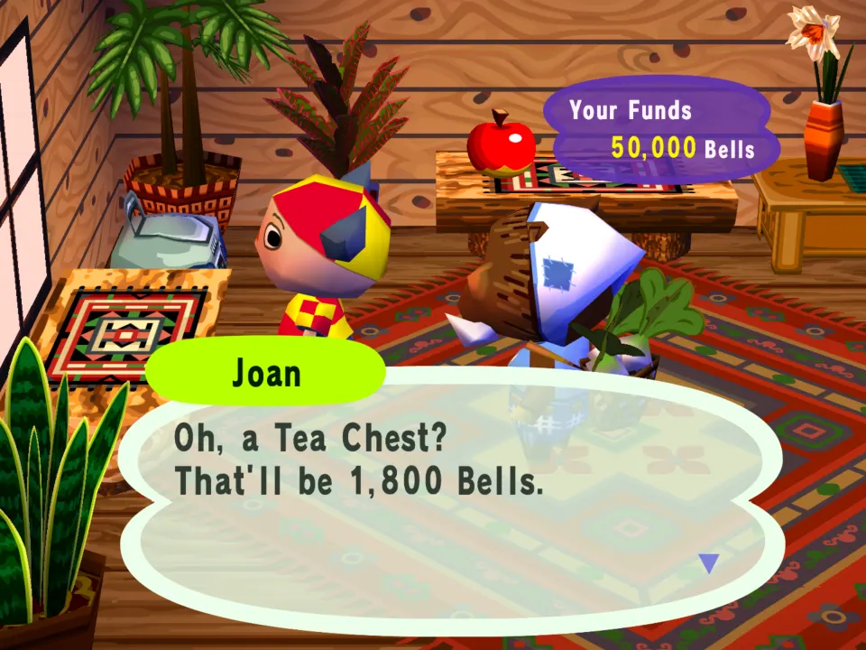
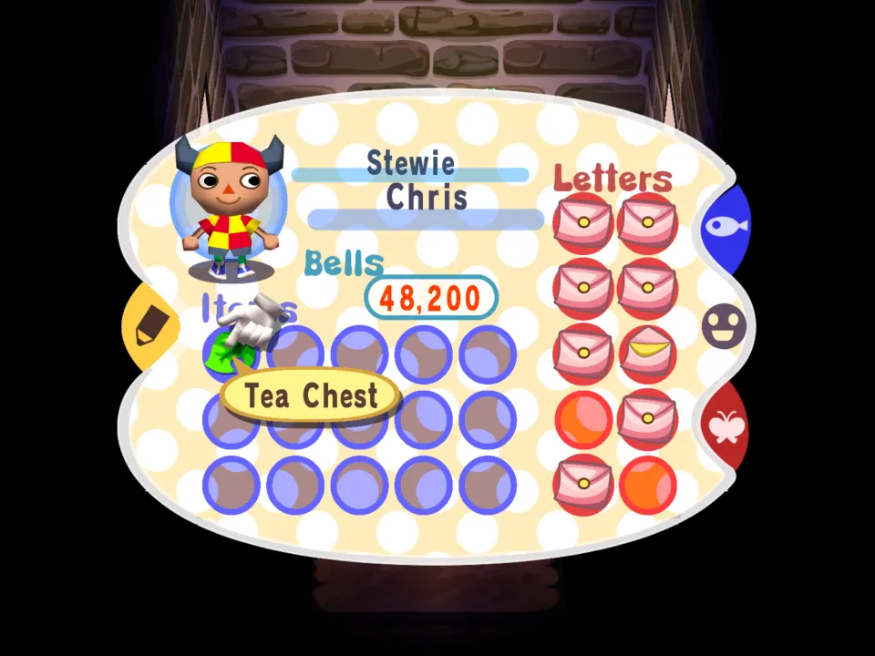
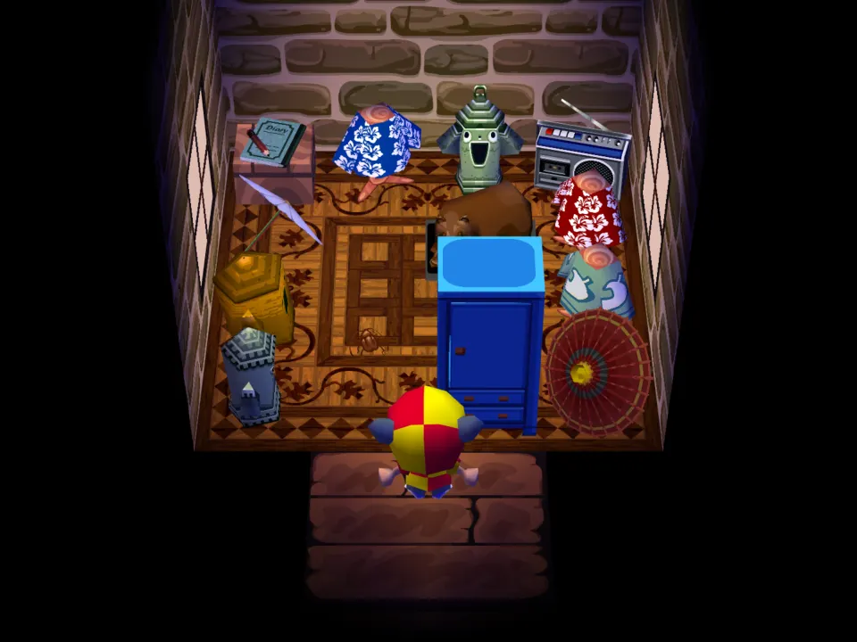
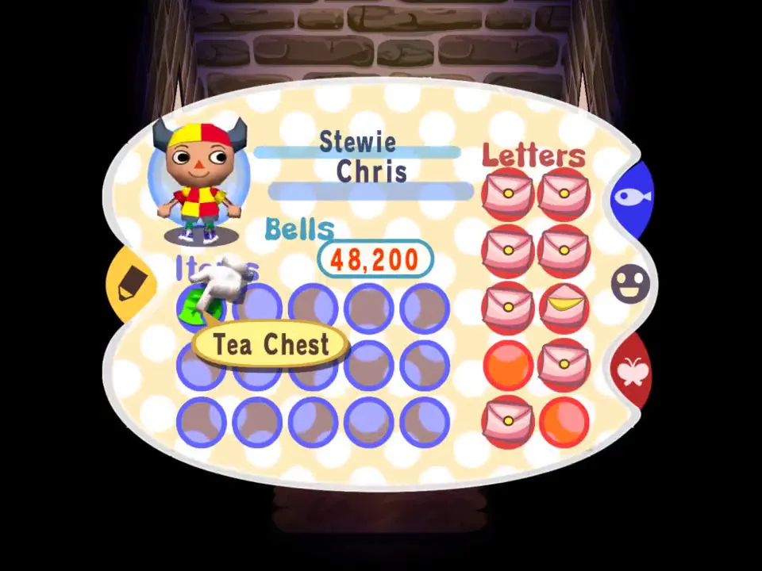

# Cosy Corner

Two pieces of furniture of its own, a Tea Chest and a Reading Chair, sold at the flower shop. Remove the mod and they stay in your house as the plain pieces they are built on; put it back and they are yours again.

## In the game

At the flower shop Joan offers the mod's Tea Chest by its own name, for 1,800 Bells.

Bought, it sits in your pockets as the Tea Chest, a mod item on top of a plain piece of furniture.

Put in your room through the pocket menu: the blue chest in the middle is the mod's Tea Chest.

The film (click the picture): Buying the Tea Chest from Joan, then putting it in the house from the pockets.
