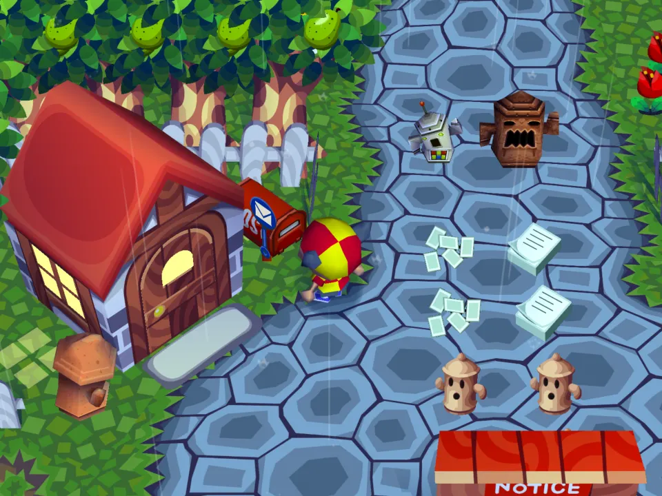
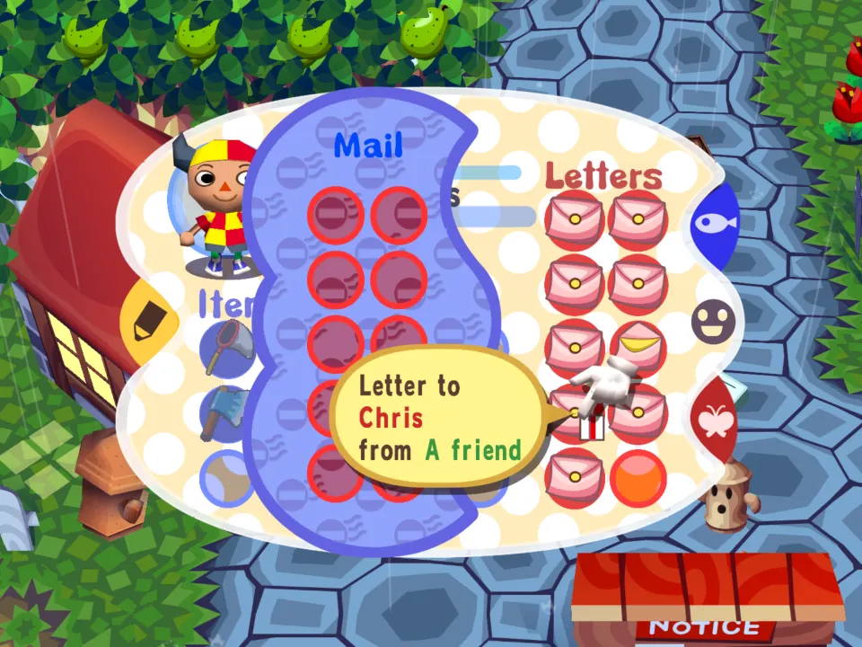
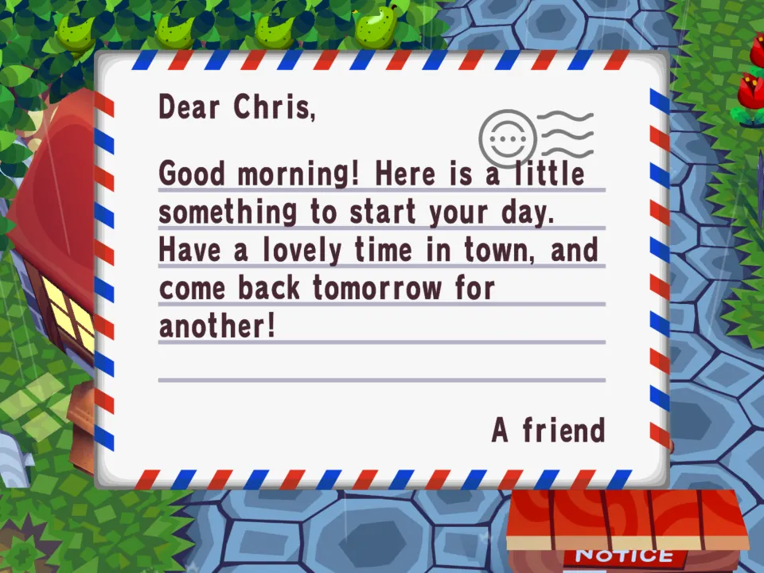
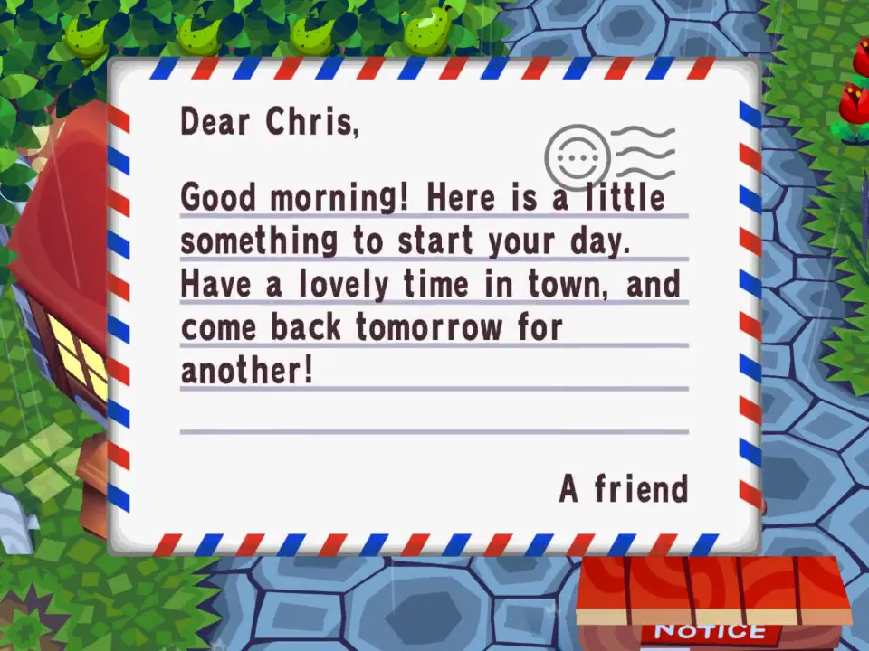

# Daily Gift

Once a game day, a letter with a little present arrives in your mailbox. A worked example of mod commands.

## In the game

The day's first visit to town: the mod's script has already mailed today's letter, so there is mail waiting at the house.

Taken from the mailbox, it is a letter to you from "A friend", sent with the send_letter command.

The letter is the mod's own text, from its messages file, with a little present attached.

The film (click the picture): Walking up to the mailbox, taking out the Daily Gift letter and reading it.
