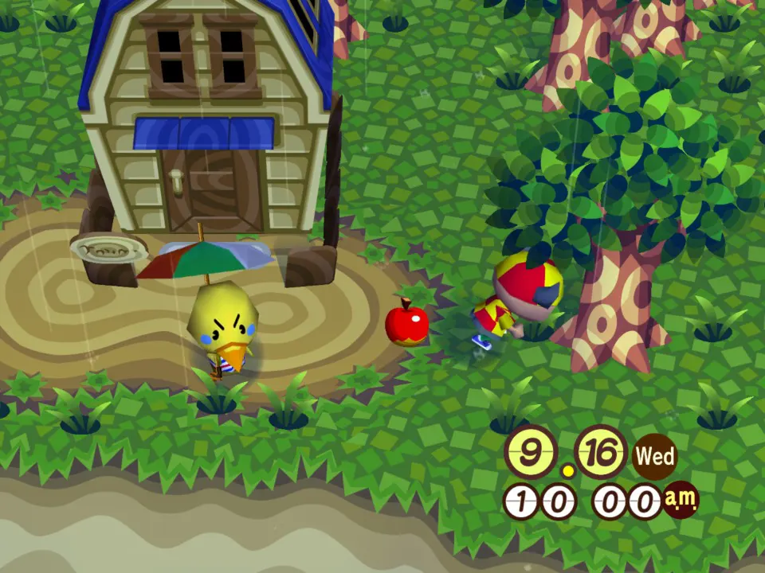
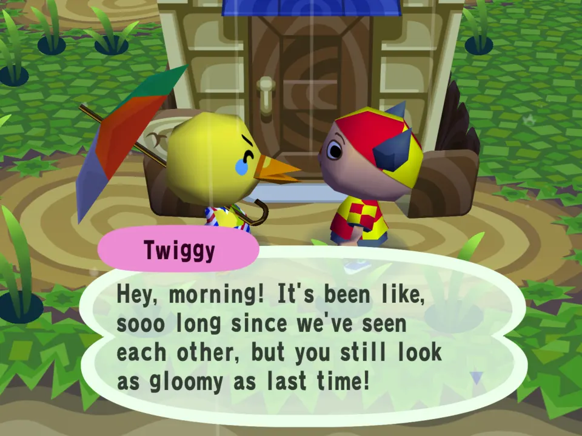
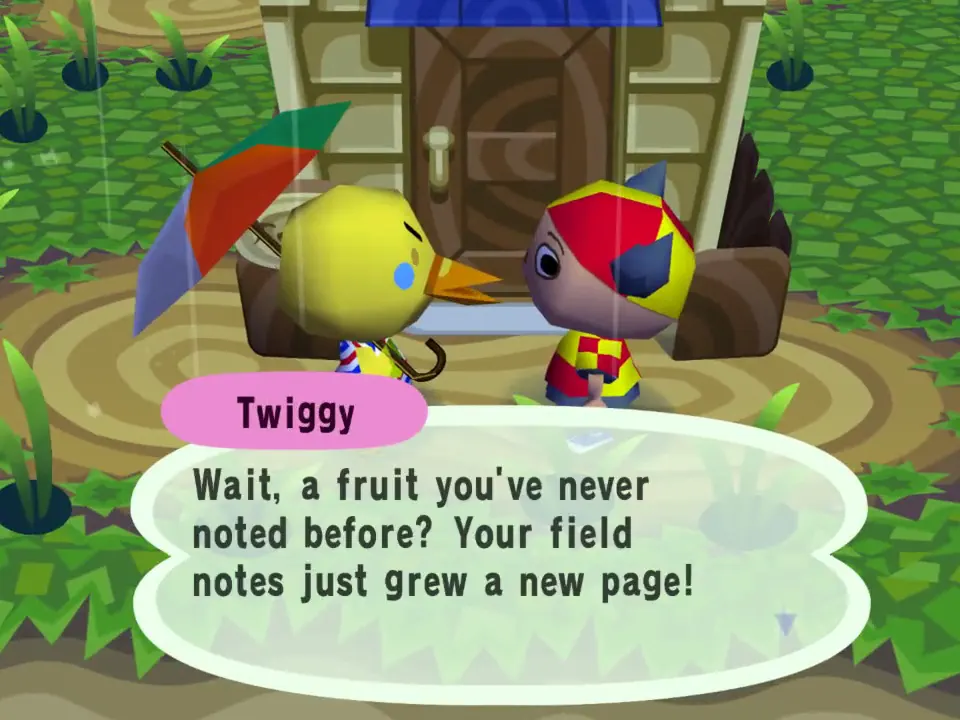

# Field Notes

Your own naturalist's journal. Every bug, fish, fossil, shell and piece of fruit
you collect goes in your notes, and villagers have something to say about it:

## In the game

An apple on the ground by Twiggy's house, about to be picked up. Every bug, fish, fossil, shell and fruit you pick up goes in your field notes.

The next villager you talk to notices the find: a fruit you had never noted before, so your field notes grew a new page.

Then the villager carries on in their own words, as the game always has them.

The film (click the picture): An apple is dropped from the pockets and picked up again, and Twiggy has something to say about the new page in your notes.

- today's haul ("2 bugs, a fish and a piece of fruit so far today!")
- a kind you have never noted before, and your very first fossil
- a new best day for one kind ("3 bugs today, a new best!")
- milestones: 25, 50, 100, 250 finds and on
- the first villager you talk to on a new day sums up yesterday, or your last
  day out if you were away

Each villager speaks for Field Notes at most once a day, and only when there is
something to say, so other talk mods (Village Gossip) still get their turn.
A villager busy with something of the game's own (an errand, a complaint,
moving out) does not speak for any mod on that talk; their note is kept for
the next one.

## Install

1. Download `example.field-notes-1.0.0.zip` from the modding downloads page.
2. In the game: Settings, Mods, Choose ZIP, then Restart now.

## What it shows off

- `item_picked` with item numbers: the API passes only the number, so
  `classify()` in `main.lua` sorts it by the game's item number ranges:

  | kind | item numbers |
  |---|---|
  | bugs | `0x2D00` to `0x2D27` |
  | fish | `0x2300` to `0x2327` |
  | fossil (not yet identified) | `0x2511` |
  | shells | `0x2514` to `0x251B` |
  | fruit | `0x2800` to `0x2804`, coconut `0x2807` |

- `store` kept small: counts are one string each (`"3,1,0,2,5"`), species seen
  are a string of `0`/`1`, a few hundred bytes in all. A `store.set` that would go
  over 8 KB raises, so `save()` wraps it in `pcall`.
- `day_start` rolls today over to yesterday; `talk` reads it once.
- `message()` templates with `{haul}`, `{n}`, `{old}` and friends filled in,
  so the words stay in `messages/en.json`.
- Returning `nil` from `talk` when there is nothing to say, so the next mod in
  the list gets the villager.

## Notes

- `store` is per town (the mod says `"api": 2`), so each town keeps its own
  journal, and it travels with that town's cloud save. On a visit to a friend's
  town the journal starts empty and is not kept.
- The day comes from `day_start`; a clock change backwards counts as a new day.
- Items you pick up off the ground always count. Bugs caught with the net,
  fish caught with the rod and items dug up count too: the game fires
  `item_picked` for every item that lands in your pockets.
- It is tested in the real script sandbox with fake finds, so every line it
  can say has been heard.
