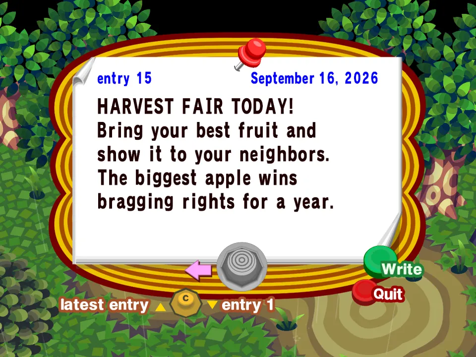
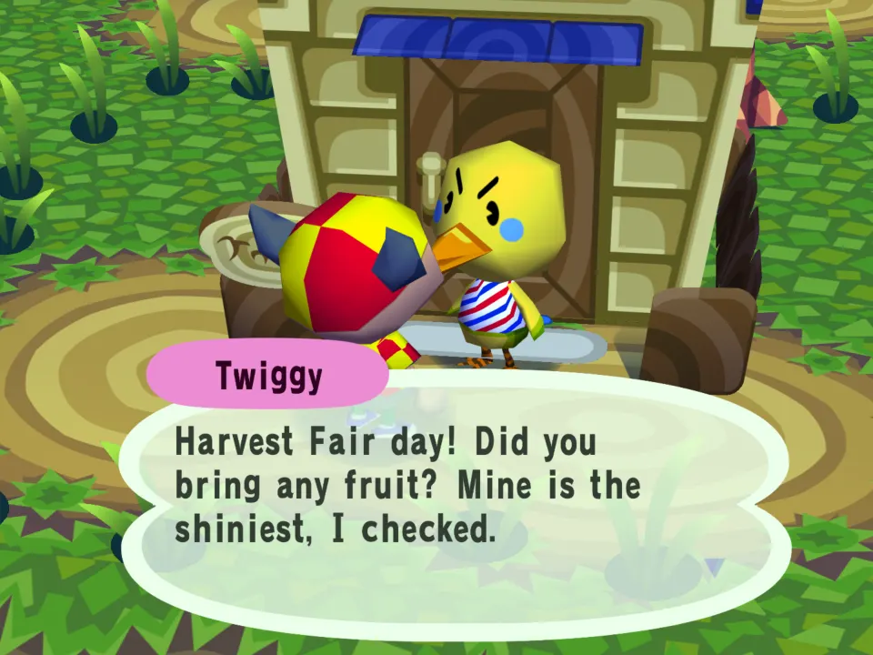
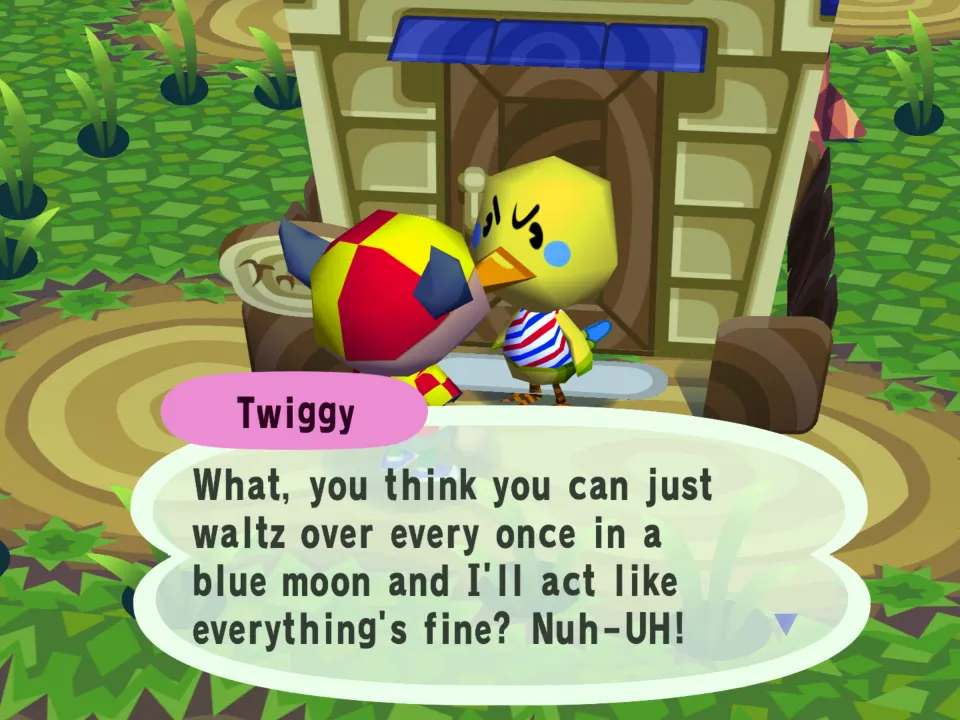
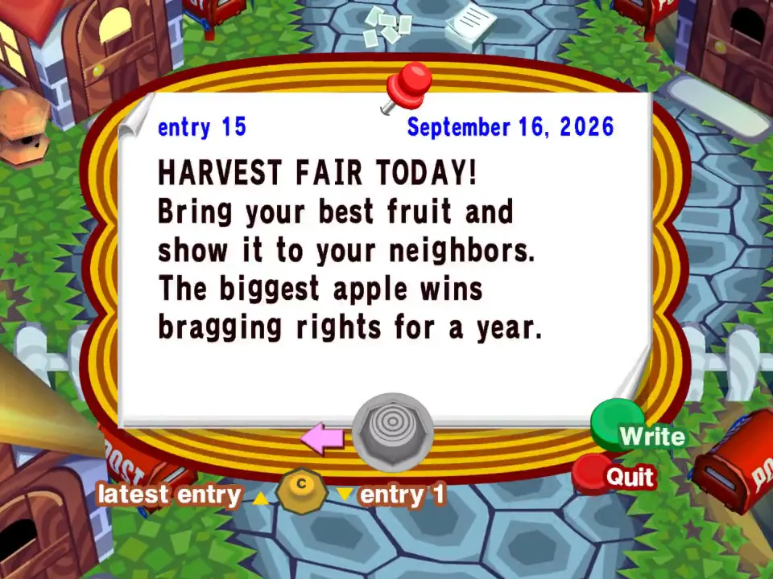

# Harvest Fair

A dated events example (`events.json`) with a letter template
(`letters.json`).

## In the game

On the third Wednesday of September the town bulletin board carries the mod's notice, dated by the game.

All day, villagers open with a line about the fair from the mod's events.json.

Then the villager carries on in their own words: the fair line comes first, nothing of the game's is lost.

The film (click the picture): The Harvest Fair notice on the bulletin board, then Twiggy talking about the fair before her usual chat.

- The Harvest Fair is the third Wednesday of September (`week` 3, `weekday` 3),
  Apple Day is October 21 (`day`). On each, a notice goes up on the town bulletin
  board, once, in the player's own town only, and villagers say one of the day's
  lines before their hello.
- A board notice changes the town, so the mod is world scope.
- `fair-thanks` is a letter a mod command can mail (`send_letter`, name it
  `example.harvest-festival:fair-thanks`): the player's name goes where
  `{player}` is, and an apple comes with it. It signs "The Fair Committee";
  the mailbox list has room for 8 characters, so `sender` names it "The Fair"
  there.

Letter and notice text is plain ASCII and must fit six lines of the paper; the
game measures it in its own font and refuses one that does not.
