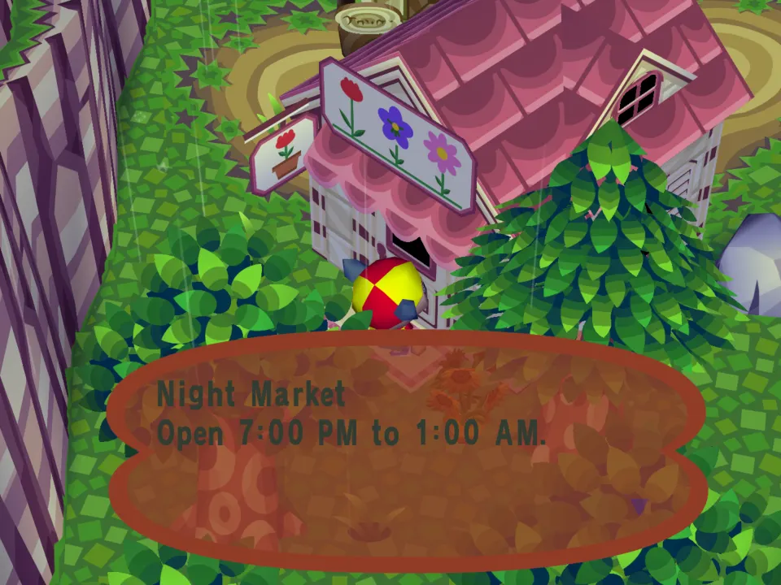
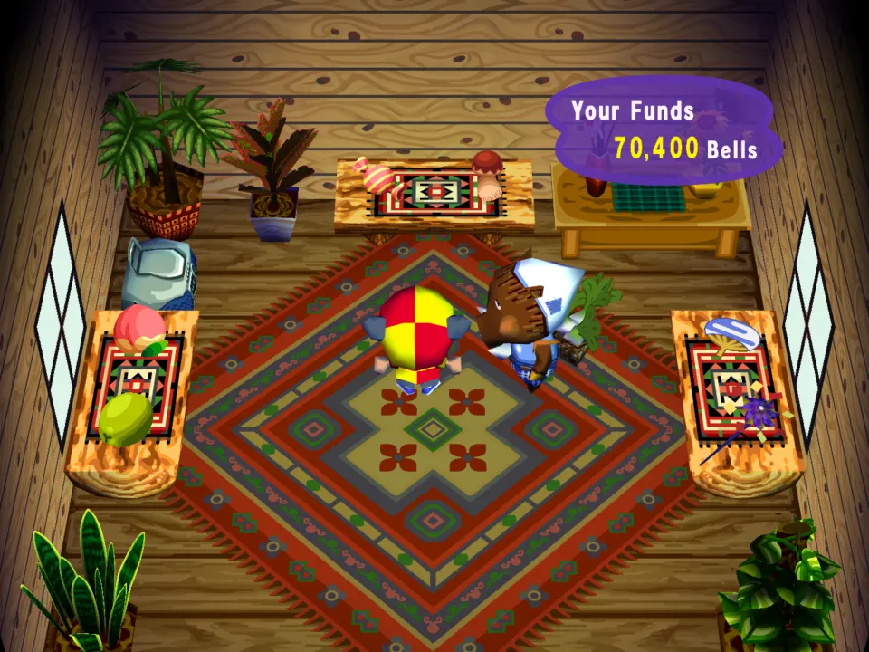
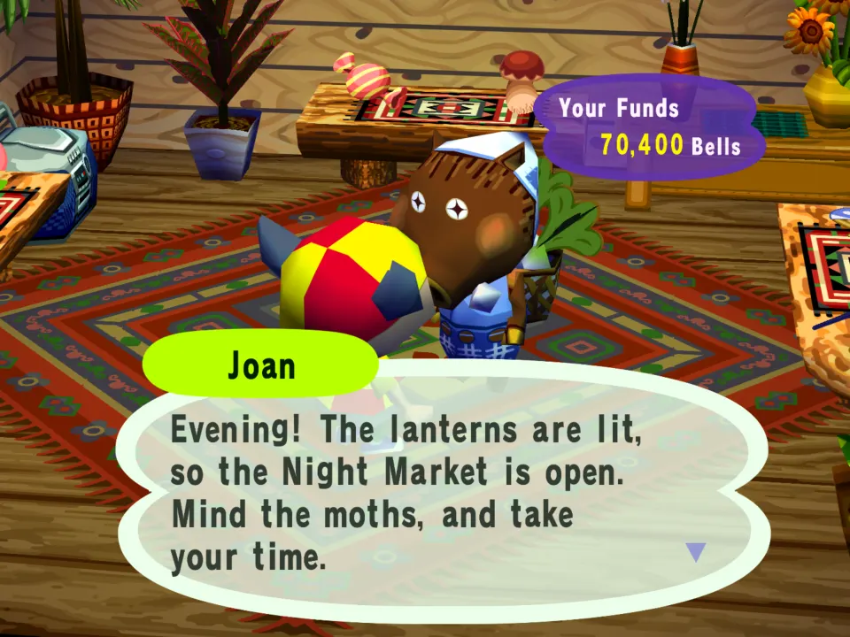
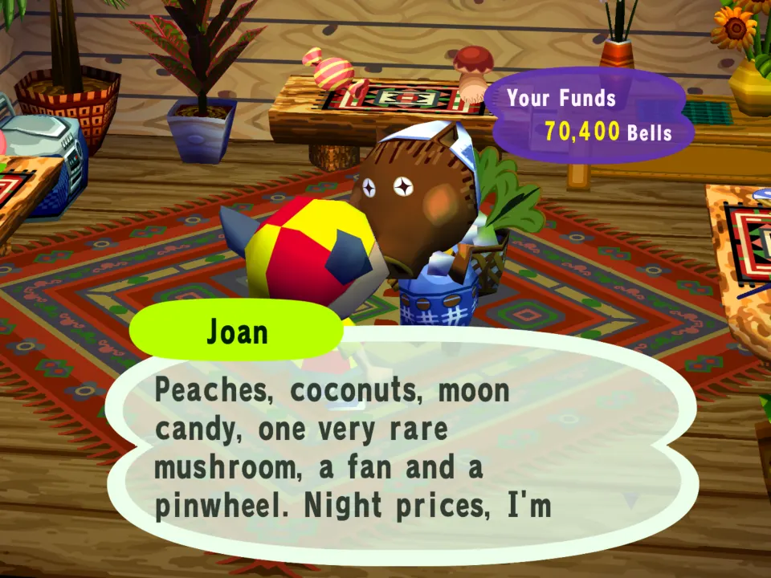

# Night Market

A world mod that puts a shop and a script together.

## In the game

At noon the flower shop is shut and its sign is the mod's: Night Market, open 7:00 PM to 1:00 AM.

At 8 PM the shop is open, and the tables hold the night market's own goods from shops.json.

Joan greets you with the mod's words: the lanterns are lit, so the Night Market is open.

Ask what's in stock and she names the night's goods: peaches, coconuts, moon candy, a rare mushroom, a fan and a pinwheel.

The film (click the picture): Knocking at noon gets the Night Market sign; at 8 PM the shop is open, and Joan's greeting and stock line are the mod's.

**The shop** (`shops.json`). After dark the flower shop becomes the Night
Market:

- Open 7 PM to 1 AM. The rest of the day the door stays shut and its sign reads
  "Night Market / Open 7:00 PM to 1:00 AM."
- Its own greeting and its own answer to "What's in stock?".
- Six goods, one per table:

  | item | | price |
  |---|---|---|
  | `0x2803` | peach | 800 |
  | `0x2807` | coconut | 700 |
  | `0x2806` | candy | 500 |
  | `0x2805` | mushroom | 6000 |
  | `0x2257` | fan | 900 |
  | `0x2253` | pinwheel | 1200 |

  Every price sits above the game's floor for the item, so the game never raises
  it. A town fruit like the peach sells to Nook for 500 Bells when it comes from
  another town, so the flower shop sells one for at least 500; a coconut's
  floor is only its own buy-back (150), and candy's 25. The mushroom sells to
  Nook for 5000, hence its price.

**The script** (`main.lua`). From 5 PM, a few villagers mention the market:
before 7 that it opens soon, after 7 that it is open, plus "tonight's special".

- `day_start` picks tonight's special from the date, so it changes every day
  and walks through all six goods in six days. Just past midnight, before the
  market shuts at 1, villagers still mean last night's special.
- `game.time().hour` decides what they say, and keeps them quiet in the day.
- It speaks rarely, so it shares villagers with other mods: about one villager
  in three, and at most three before 7 and three after. A villager says each
  once a night. Everyone else is left for other mods' lines (the first mod
  that returns a line wins a talk).

**What it can't do.** The special is talk only. The stock and its prices are
the same every night, because `shops.json` is data the game reads once at boot
and a script has no way to change a shop. A villager calling the peach
"tonight's special" does not make it cheaper.

Other mods can read the market's hours as `example.night-market:hours`.
