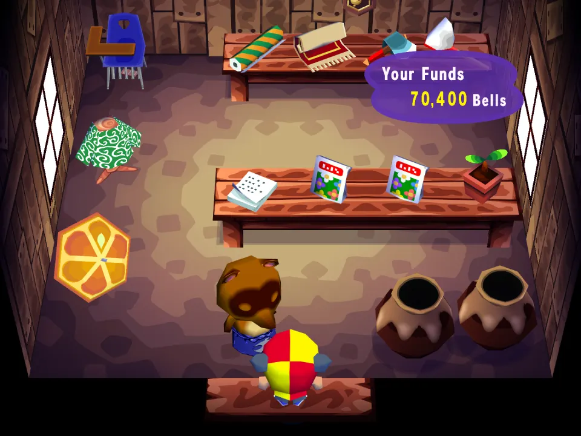
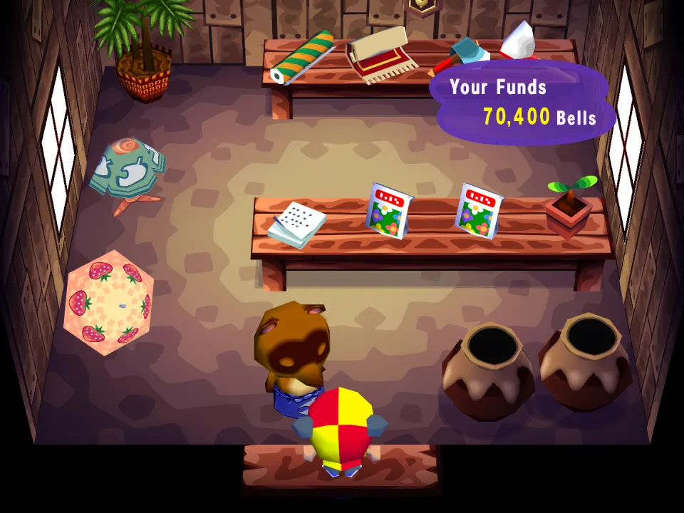

# Nook's Extras

A Nook's stock example (`shops.json`, target `nook`). World scope: a
visitor sees the same shelves, so a friend visit needs the same mod on both sides.

## In the game

Before: Nook's Cranny on the morning of September 16 with no mods, his own goods in every spot.

After: the same morning with Nook's Extras. Four spots now hold the mod's goods (the palm plant, the shirt, the strawberry umbrella and a rug on the back table) beside Nook's own stock.

The film (click the picture): A walk round Nook's Cranny with Nook's Extras installed: the mod's goods sit in the spots of their own kind, among his usual stock.

`"mode": "add"` keeps Nook's own roll and puts these goods in at most half of the
spots of their kind each day: three pieces of furniture, two umbrellas (one
umbrella spot, so the date picks which one shows), a shirt and a rug. A price is
the mod's floor price, never below what Nook pays back; no price is retail.

Changes show from the next restock, the morning after the mod is switched on.
In the City Nook's stock is the game's own.
