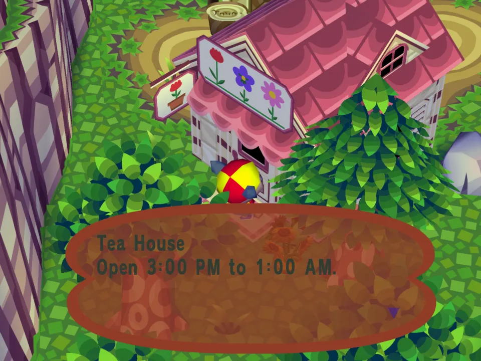
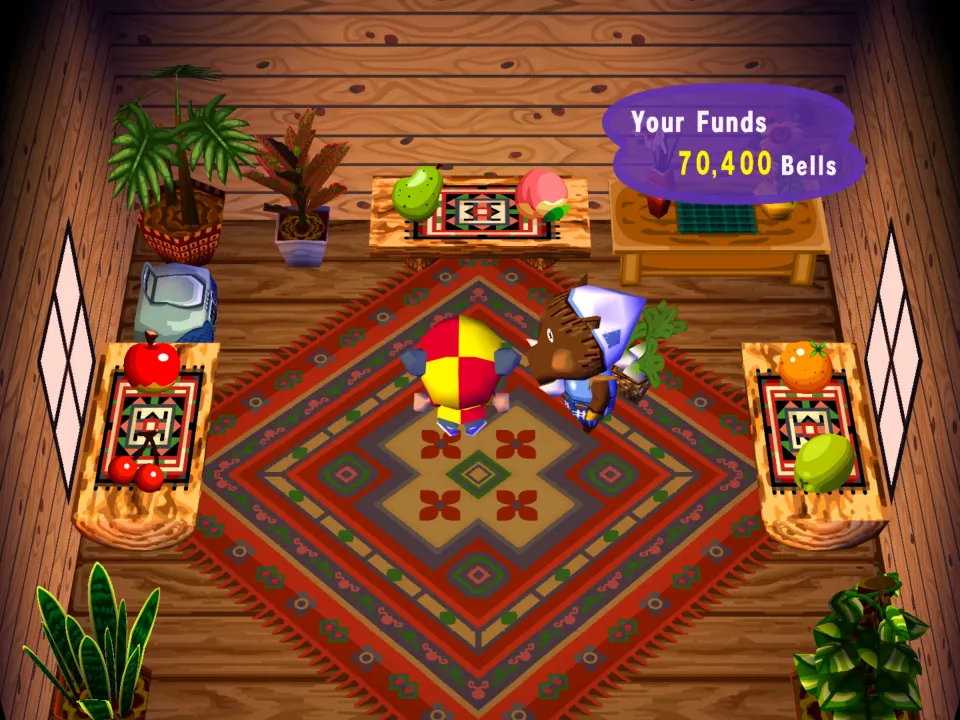
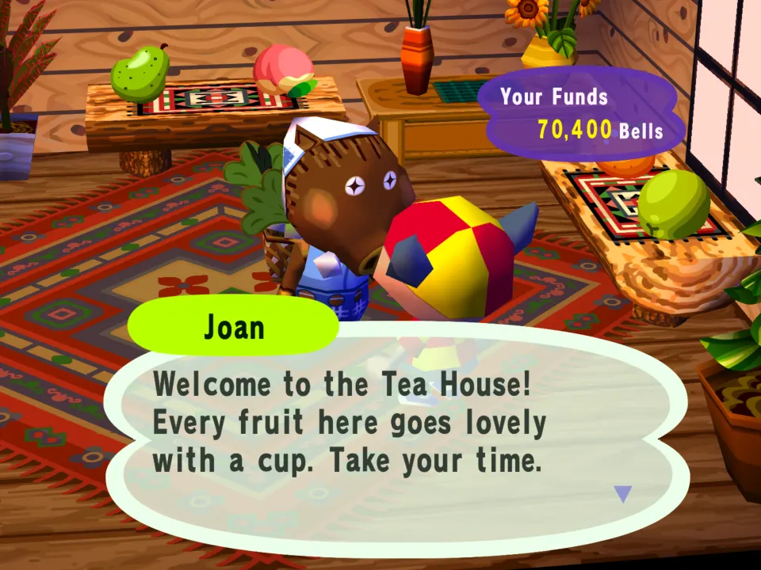
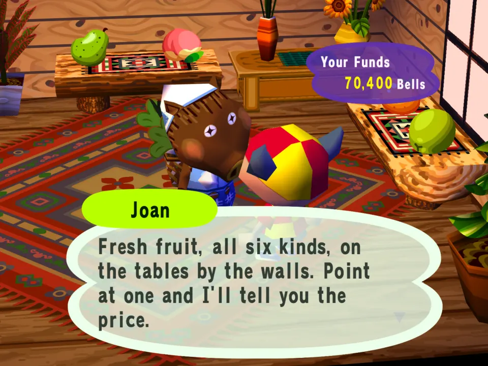
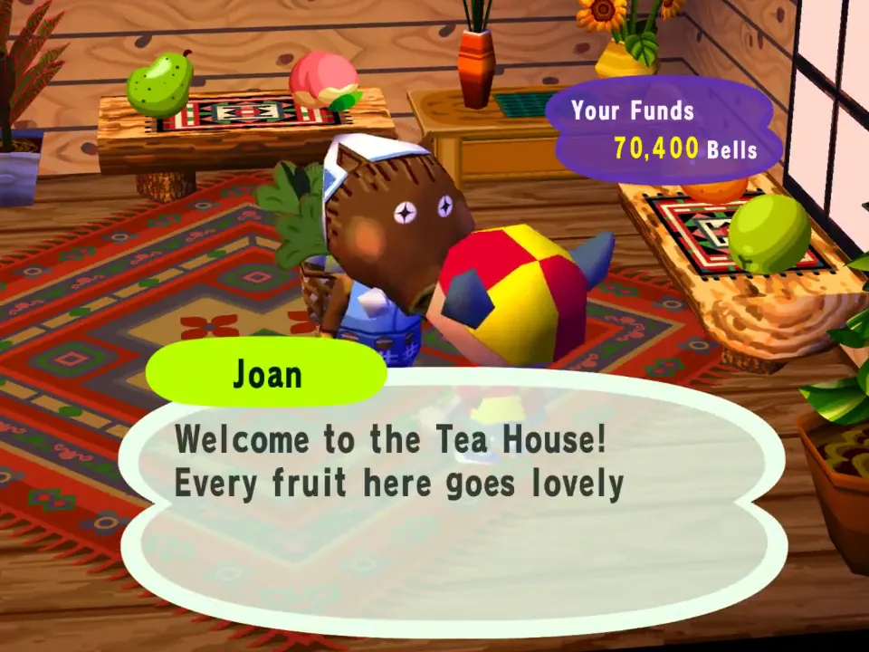

# Tea House

The flower shop becomes a tea house in the evening: its own greeting, its own hours, and fruit for tea on every table.

## In the game

At noon the flower shop's door stays shut and its sign is the mod's: Tea House, open 3:00 PM to 1:00 AM.

Inside at 6 PM: the tables hold the mod's six fruits, at the mod's prices.

Joan greets you with the mod's words from shops.json.

Ask her what's in stock and she answers with the mod's stock line.

The film (click the picture): Knocking at noon gets the Tea House sign and its hours; in the evening the shop is open, and a chat with Joan is the mod's greeting and stock line.
