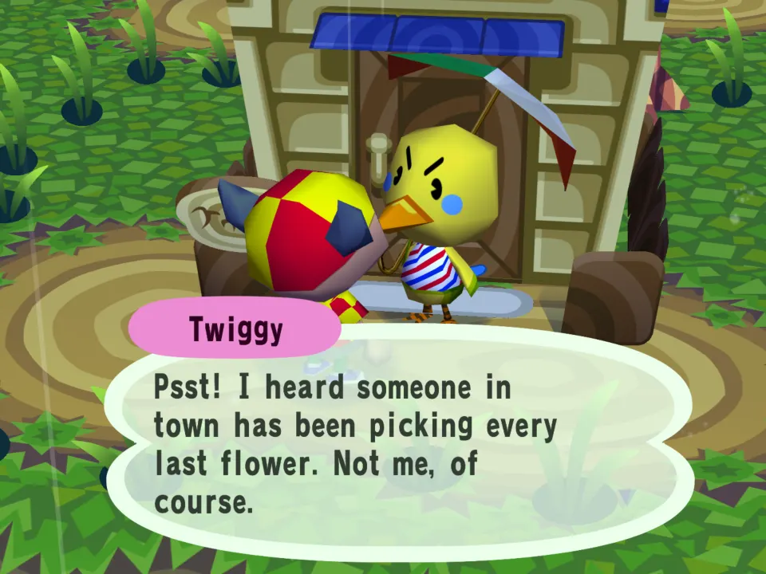
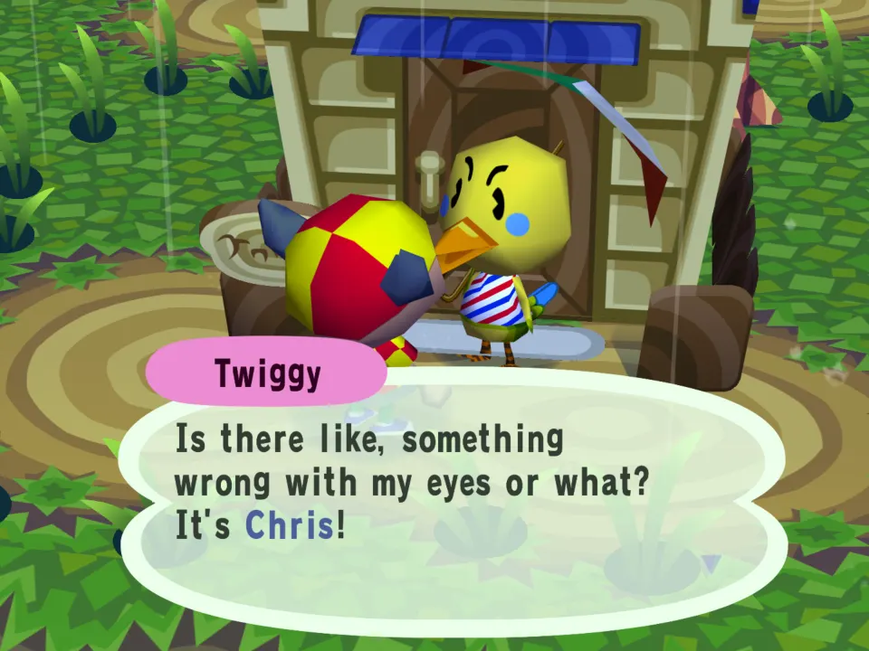
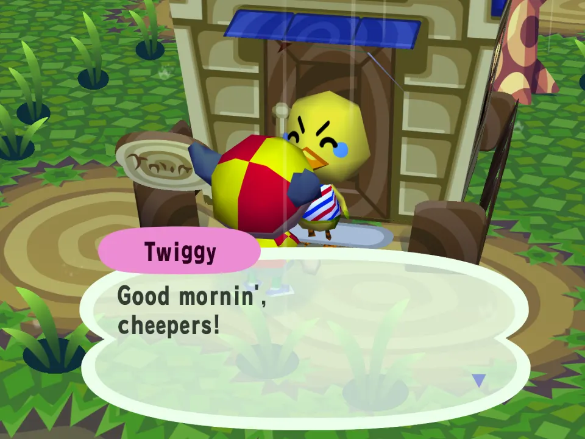
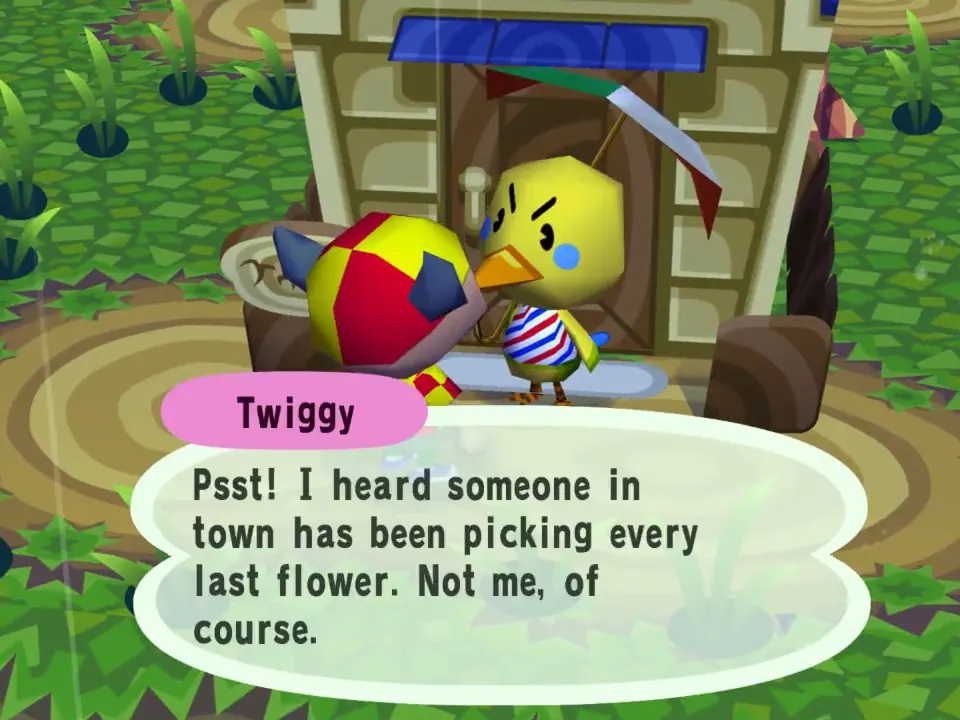

# Village Gossip

Once a day, each villager you talk to shares a bit of town gossip before their usual hello.

## In the game

The first talk of the day with a villager opens on a bit of town gossip from the mod's script, in the villager's own window.

The next page is the villager's own words: the gossip comes before the conversation and never replaces it.

Talk to the same villager again that day and there is no gossip: once a day per villager.

The film (click the picture): Walking up to Twiggy: her first talk of the day starts with the mod's gossip, then carries on as usual.
