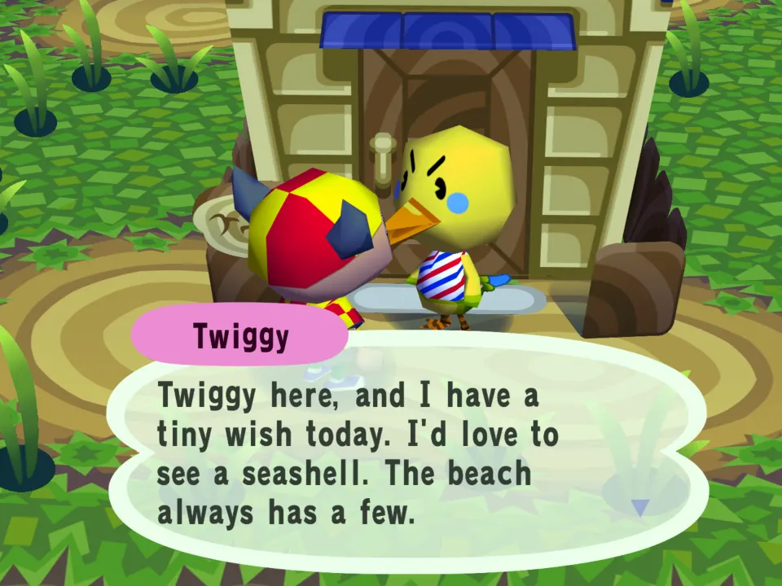
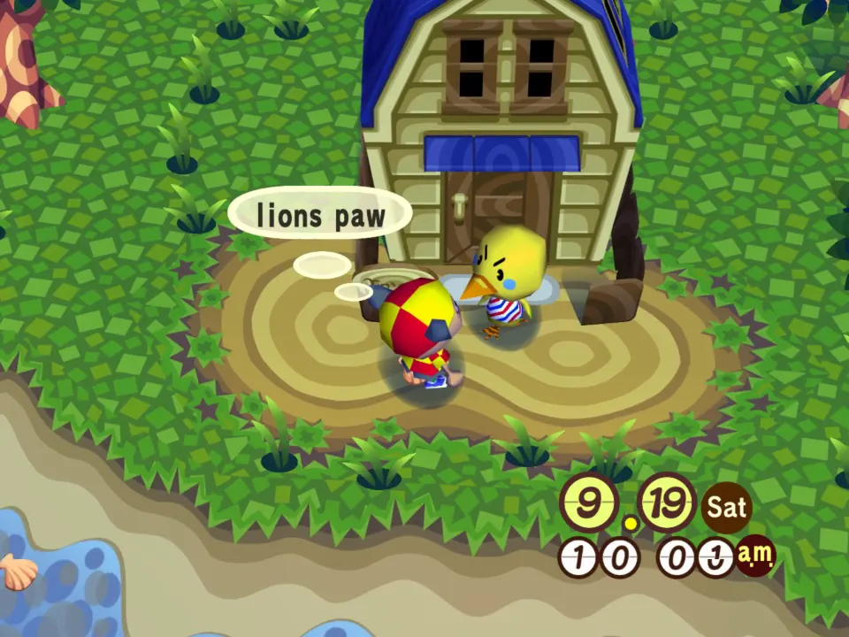
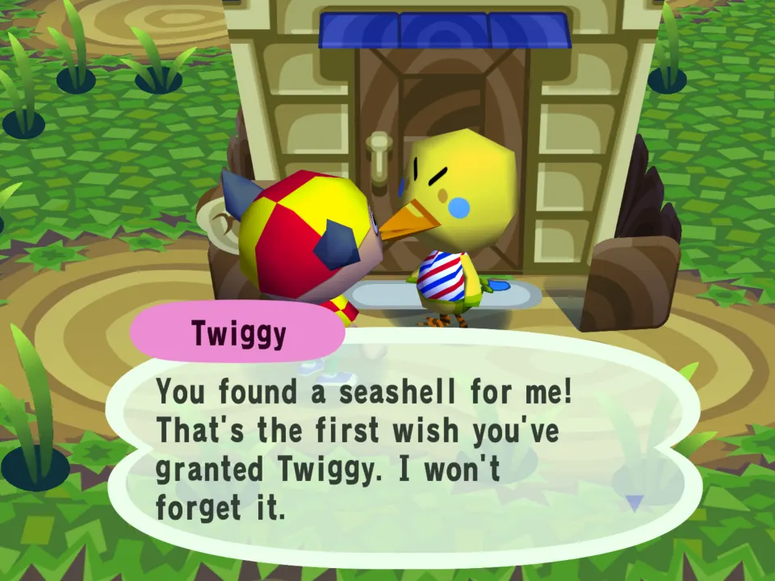
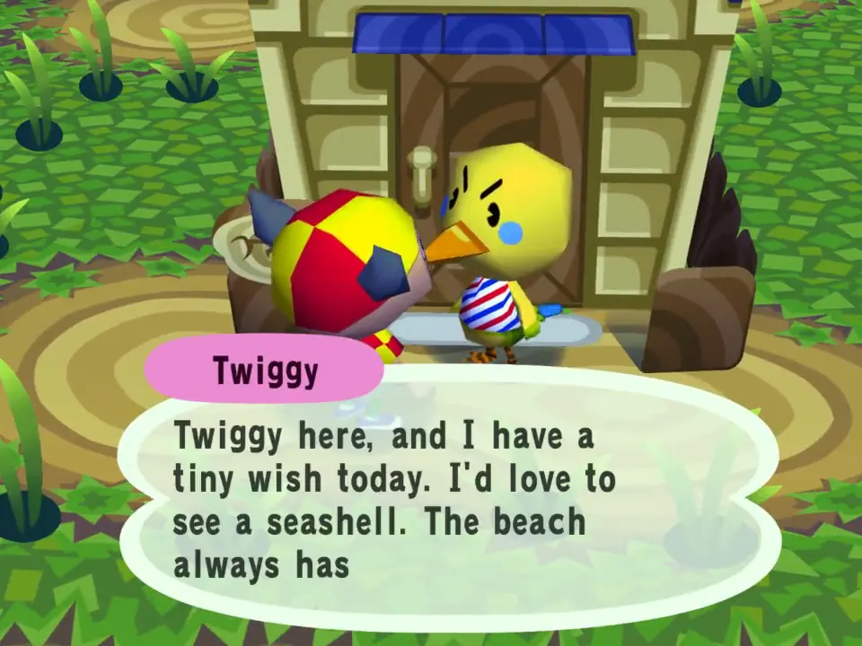

# Wish List

A script example: tiny daily quests.

## In the game

Twiggy has a tiny wish today: a seashell. About two villagers in five wish each day, picked from the date.

A lion's paw shell, dropped from the pockets and picked up off the ground: the script hears item_picked and grants the wish.

The next talk opens on her thank-you, and the script counts your wish streak with her.

The film (click the picture): Twiggy wishes for a seashell; one is picked up, and her next talk thanks you for the first wish granted.

Each day about two villagers in five make a wish: a seashell, a piece of fruit,
a bag of bells, a mushroom in November, or a fruit you have picked up before
(so nobody wishes for a fruit that does not grow in your town). The wish comes
from the date and the villager, so it is the same all day, after a restart too.

1. Talk to a villager. If they have a wish today, they tell you, once.
2. Pick the thing up from the ground (shake a tree, walk the beach, hit a rock).
3. Talk to them again. They thank you and count your **wish streak**: wishes
   granted in a row. Three, five, ten and every ten after that get their own line.
   A wish the day ends on breaks the streak, and the villager mentions it, kindly,
   next time they wish.

When a villager has something of the game's own to say (an errand, a complaint,
moving out, a pitfall), that talk belongs to the game: no mod hears it, so the
wish or the thank-you waits. Talk to them once more and it comes. Nothing is
lost: a granted wish counts for your streak the moment you pick the thing up.

## What it does not do

Mod handlers only return data: a script cannot give items, bells or friendship
points, or change anything in the town. The reward is the story and the streak.

A wish is granted when the item lands in your pockets or wallet (`item_picked`):
picked up, caught or dug up. Buying it does not count. Wishes stick to things
found around town (shells, fruit, bells, mushrooms). Dropping a shell and picking
it back up counts. The villagers are trusting folk.

## How it is built

- `main.lua` uses `talk`, `day_start` and `item_picked`.
- Special and event talks never call `talk` (see the scripts guide). A wish
  is only marked told, and a thank-you only marked given, inside a `talk` that
  returns the line, so a talk the game kept for itself loses nothing: the next
  ordinary talk says it.
- `talk` returns nil unless it has a wish to state or a thank-you to give, so
  with other talk mods installed it only takes the villagers it has news for
  (the first mod in load order with a line wins a talk).
- The wish is a hash of the date and `npc.id`. The day comes from `game.time()`,
  so it also changes past midnight and after a clock change; `day_start` alone
  would miss a save loaded on the day it was last played.
- `store` keeps today's wishes (so a restart does not repeat them), the fruits
  you have picked up, and each villager's `streak,total,missed`, for the 48
  villagers seen most recently. Under 2 KB of the 8 KB. Every `store.set` is
  wrapped in `pcall`: a refused write must not stop the script.
- The store is per browser, not per town.
- Under 2,000 instructions per event with 60 villagers, against a budget of 200,000.
- Lines are in `messages/en.json`, with `{name}`, `{wish}`, `{hint}` and `{streak}`
  filled in by the script.

It is tested in the real script sandbox against these exact files.
